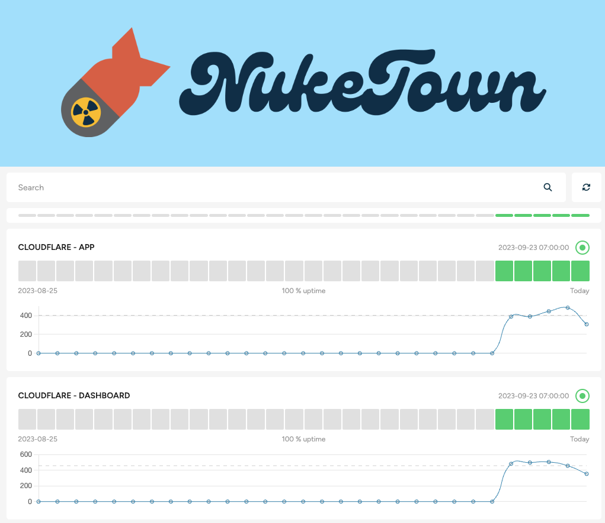

# NukeTown

Uptime monitoring and status pages for your APIs and websites, without the noise.

NukeTown checks your endpoints every 5 minutes, tells your team the moment a status code changes, and keeps your users informed with a public status page.

- Website: [nuketown.io](https://nuketown.io/)
- Dashboard: [dashboard.nuketown.io](https://dashboard.nuketown.io/)
- Live demo: [status.nuketown.io](https://status.nuketown.io/)

It is a SaaS service: no agents, no installation. Add a URL, choose the status codes you expect, and you're monitoring.

## Status pages

Every status page lives on a NukeTown subdomain or on your own domain, and you can customize:

- logo and header
- website link and copyright

Each page shows the live status of its services, uptime history and response times, and the incidents you publish, with their updates.

On the Enterprise plan a status page can be protected by a password.

## Alerts

NukeTown sends an alert when an endpoint's status code changes, on:

- Discord
- Slack
- Microsoft Teams
- Telegram
- Webhooks

## Teams

The owner of a status page can share it with other people by email. Members manage endpoints, alerts and incidents of that page; only the owner can delete the page, change its plan or manage members.

## Pricing

Prices are per status page per month, VAT excluded.

| Plan | Endpoints | Price |
|---|---|---|
| Free | 5 | €0, forever |
| Professional | 20 | €9 |
| Business | 100 | €29 |
| Enterprise | 500 | €49, adds password-protected status pages |

Every plan includes checks every 5 minutes, unlimited alerts, a public status page with incident updates, custom domain, logo and header, and 90-day data retention. Pay yearly and get 2 months free.

Need more than 500 endpoints? [Talk to us](mailto:hello@nuketown.io).

## Support

- Join our [Discord server](https://discord.nuketown.io/)
- Write to [hello@nuketown.io](mailto:hello@nuketown.io)
- Open an issue on [GitHub](https://github.com/nuketown-io/.github/issues/new)
